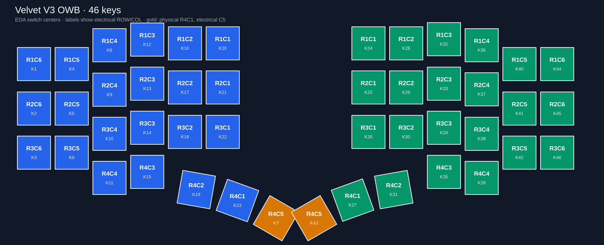

# Velvet V3 OWB for ZMK

[中文说明](README_zh.md)

Open-source ZMK shield module for the 46-key Velvet V3 OWB matrix. The default controller is **nice!nano v2** (`nice_nano//zmk`) on ZMK/Zephyr 4.1. The electrical map comes from the current OWB switch/diode nets and the holder's nice!nano pinout; this repository does not contain PCB/CAD source or personal keymap settings.

## Firmware roles

| Build | Controller | Purpose |
| --- | --- | --- |
| `velvetv3_owb_left` | nice!nano v2 | Left central for ordinary two-half split |
| `velvetv3_owb_right` | nice!nano v2 | Right peripheral |
| `velvetv3_owb_ph_left` | nice!nano v2 | Left peripheral when a dongle is central |
| `velvetv3_owb_dongle` | nice!nano v2 | Headless two-peripheral dongle |
| `velvetv3_owb_left_niceview` / `velvetv3_owb_right_niceview` | nice!nano v2 | Optional native nice!view on holder socket |
| `velvetv3_owb_neoncat_dongle` | XIAO BLE / Prospector | Optional public Neon Cat ST7789 dongle |

`build.yaml` contains all seven targets. Central builds enable ZMK Studio and the DYA Studio extensions (BLE management, battery history, settings RPC, runtime input processing, and runtime macros). Peripheral builds leave Studio disabled but enable the matching split settings-event relay. The nice!view targets reuse upstream `nice_view_adapter nice_view`: the holder's D2/MOSI, D3/SCK, D1/CS socket matches the adapter's nice!nano pin assignment. Do not enable the display together with another peripheral that claims D2/D3/D1 without resolving the shared bus and CS pins.

The optional Neon Cat target uses the public [`zdse-themes`](https://github.com/hitsmaxft/zdse-themes) theme and [`zmk-dongle-screen-engine`](https://github.com/hitsmaxft/zmk-dongle-screen-engine) host. Its display shield is for XIAO BLE plus a Prospector-compatible 280×240 ST7789/CST816S assembly; it is **not** a nice!nano display pinout. The display hardware overlay was adapted from the MIT-licensed [Prospector ZMK module](https://github.com/t-ogura/prospector-zmk-module). The normal nice!nano dongle remains the default.
The Neon Cat target uses a 64-line coherent-strip renderer at 24 FPS; its verified firmware build uses 153,448 of 262,144 RAM bytes (58.54%).

## Matrix and physical layout

The 46 switch positions and actual ROW/COL assignments are enumerated in [`docs/matrix-map.csv`](docs/matrix-map.csv). The 46-key physical layout uses the switch centers and rotations measured in the saved EDA native data. The transform orders keys left outside-to-inside, then right inside-to-outside. On each half row 4's innermost/thumb position is **electrically R4C5**; it is the fifth key of the left bottom row and first key of the right bottom row. This corrects the mismatch between physical key order and GPIO matrix numbering in the ZMK transform, without renaming any PCB nets.



| Holder pin | nRF52840 GPIO | Left matrix | Right matrix |
| --- | --- | --- | --- |
| D5 | P0.24 | R1 | R1 |
| D6 | P1.00 | R2 | R2 |
| D7 | P0.11 | R3 | R3 |
| D8 | P1.04 | R4 | R4 |
| D10 | P0.09 | C6 | C1 |
| D16 | P0.10 | C5 | C2 |
| D14 | P1.11 | C4 | C3 |
| D15 | P1.13 | C3 | C4 |
| A0/D18 | P1.15 | C2 | C5 |
| A1/D19 | P0.02 | C1 | C6 |

D9/P1.06 remains unassigned for the future fifth-row version. The current board is four rows, with `col2row` diodes. Do not mirror the right connector pin numbers onto the left; the column orders differ.

To verify the mapping against a local EDA native JSON capture:

```sh
python3 scripts/check_matrix.py --eda /path/to/reloaded-native.json
```

Without `--eda`, the checker validates all 46 matrix positions, transform uniqueness, both GPIO maps, and physical-layout count from this repository alone.
Run `python3 scripts/render_layout.py --check` to verify that the README diagram and ZMK physical-layout DTSI both match those coordinates. EDA centers are rounded to the nearest 0.01 keyboard unit; the largest center error in the current 46-key table is 0.128 mm.

## Build and installation

This repository follows the `zmk-keyboard-cornix` module pattern: `zephyr/module.yml` registers the board root, `config/west.yml` pins the ZMK 4.1/DYA and display dependencies, and `build.yaml` describes targets. In a ZMK config workspace, add this repository as a West project, then build the chosen shield. Use the **same physical layout and transform** on a dongle and both peripheral images. In dongle mode flash `velvetv3_owb_ph_left`, `velvetv3_owb_right`, and one dongle target. Re-pair both halves after changing between left-central and dongle-central roles.

Build verification checks `CONFIG_NVS=y` and `CONFIG_SETTINGS_NVS=y`, with `CONFIG_SETTINGS_NONE` absent, on the final nice!nano `.config`. Source-level GPIO validation and a successful firmware build do not establish FPC cable orientation, physical display wiring, or BLE pairing on the assembled hardware.

## License

The shield module is Apache-2.0. The adapted Prospector display overlay is MIT; its SPDX header and attribution remain in that file.
